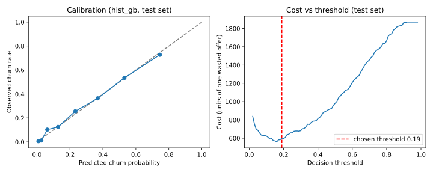

# telco-churn-pipeline

Customer churn prediction on the public IBM Telco dataset (7,043 customers, 26.5% churn), built the way it would be done for a real decision: no leakage, honest model choice, calibrated probabilities, and a decision threshold picked from costs rather than the default 0.5.

## Result (held-out test set, 1,409 customers, touched once)

| Metric | Value |
|---|---|
| Model (picked by cross-validated PR-AUC on the training set) | Gradient boosting (`HistGradientBoostingClassifier`) |
| ROC-AUC | 0.849 |
| PR-AUC (baseline = churn rate 0.265) | 0.657 |
| Brier score | 0.135 |
| Chosen threshold | 0.19 |
| Recall / precision at that threshold | 0.87 / 0.48 |

Cross-validated comparison on the training set (5-fold, stratified):

| Model | ROC-AUC | PR-AUC | Brier |
|---|---|---|---|
| Prior baseline | 0.500 | 0.265 | 0.195 |
| Logistic regression | 0.844 | 0.654 | 0.136 |
| Random forest | 0.845 | 0.664 | 0.135 |
| Gradient boosting | 0.848 | 0.673 | 0.134 |

The three real models are within about one standard deviation of each other (ROC-AUC std about 0.01). Gradient boosting was selected by the rule above, but a plain logistic regression is almost as good and easier to explain. On this dataset the model choice matters much less than the preprocessing and the threshold.



## The decision part

Assumption, stated so you can change it in `churn/run.py`: contacting a customer who would not have churned costs 1 unit (a retention offer), and missing a customer who churns costs 5 units. These costs are illustrative, not from a real company.

The threshold is chosen on out-of-fold predictions from the training set, then evaluated once on the test set:

| Policy | Test cost |
|---|---|
| Contact nobody | 1870 |
| Contact everybody | 1035 |
| Model, threshold 0.5 | 982 |
| Model, chosen threshold 0.19 | 600 |

So the model with a cost-based threshold cuts cost by about 42% against contacting everybody under these assumed costs. With a different cost ratio the best threshold moves (there is a test for that).

## What I did to avoid fooling myself

- All preprocessing (imputation, scaling, one-hot encoding) is inside the scikit-learn `Pipeline`, so cross-validation never learns from a held-out fold.
- 11 customers have a blank `TotalCharges` (new customers with tenure 0). They are imputed with the training median instead of being dropped.
- The test set is used once, for the final numbers. Model choice and threshold use only the training data.
- The calibration plot shows predicted probabilities line up with observed churn rates, so the probabilities can be used directly in cost calculations.
- Top features by permutation importance on the test set (drop in PR-AUC): `tenure` (0.108), `Contract` (0.101), `TotalCharges` (0.045), `MonthlyCharges`, `InternetService`. This shows what the model relies on, not what causes churn.

## Limits

- One dataset, one split, a sample dataset with no timestamps. In production you would validate on a later time period, which can behave differently.
- `TotalCharges` is close to `tenure x MonthlyCharges`, so those three features overlap.
- The cost ratio is assumed. The recall and precision above depend on it.

## Run it

```bash
pip install -r requirements.txt
python -m churn.run   # writes results/ (about 15 seconds)
pytest
```

Data: IBM sample dataset "Telco Customer Churn", downloaded to `data/telco.csv` on first run from https://github.com/IBM/telco-customer-churn-on-icp4d.
